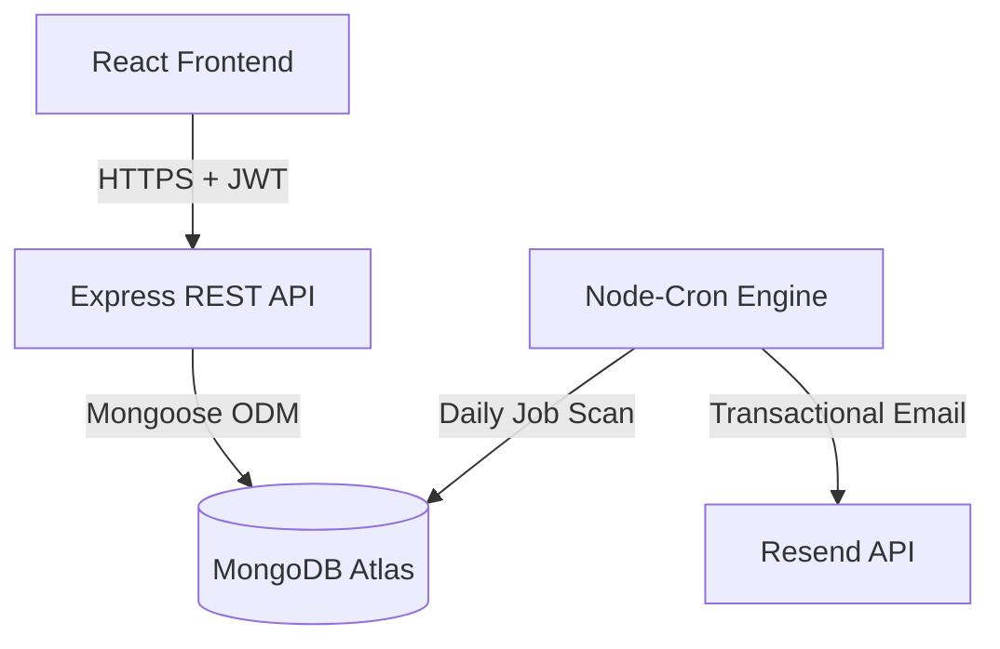

# Architecture Document — JobPulse 🏗️

This document describes the high-level system architecture, design patterns, security controls, and scheduling mechanisms used in JobPulse.

---

## 1. System Overview

JobPulse is built on a MERN stack (MongoDB, Express, React, Node.js) with a decoupled client-server architecture:

- **Frontend Client**: Single-Page Application (SPA) compiled via Vite. Uses React Router for routing, Context API for global auth state, Axios for HTTP communication, and Recharts for dashboard analytics.
- **Backend API Server**: Node.js and Express RESTful API. Handles user management, job applications, interview schedules, settings, and analytical aggregation pipelines.
- **Database**: MongoDB instance storing application, user, and interview records.
- **Background Jobs**: Node-Cron runs inline in the Node process to process follow-up rules, deadline notifications, and ghost-job flags.

---

## 2. Technical Stack Details

### Backend
- **Express**: Router-based routing, global middleware for CORS, body parsers, rate limiters, and error handling.
- **Zod v4**: Type-safe parser/validator executing schemas for body requests and queries. Replaces manual validation.
- **Bcryptjs**: Used to securely hash user passwords with a salt factor of 12 before database insertion.
- **Jsonwebtoken**: Generates signed tokens containing user IDs with a default 7-day expiration.
- **Helmet**: Disables headers like `X-Powered-By`, enforces HSTS, sets MIME-type sniff protection, and sets XSS filters.

### Frontend
- **React**: Functional components using hooks (`useState`, `useEffect`, `useMemo`, `useCallback`).
- **Axios**: Interceptor-configured client adding `Bearer` token to headers and intercepting `401 Unauthorized` responses to clear auth context and logout.
- **Recharts**: Responsive SVGs rendering data funnels, donut status splits, area activity timelines, and conversion bar charts.

---

## 3. Background Processing & Automation

The file `followUpJob.js` defines background routines executed daily at `09:00 UTC` (or scheduled via `CRON_SCHEDULE` environment variable):

### 1. Follow-Up Nudges
Checks for applications in `Applied` status. If the application hasn't been updated within the user's custom `followUpWindowDays` (default 7 days):
- Flags `needsFollowUp = true`.
- Sends a follow-up reminder email via Resend.
- Sets `followUpNotified = true`.

### 2. Ghost Job Archiving
If an application is in `Applied` or `Assessment` status with no activity for 30+ days (or 4x the user's custom follow-up window, whichever is greater):
- Sets `isGhosted = true` and `ghostedAt = new Date()`.
- The application remains in its current board column but shows a ghost icon and is excluded from active pipeline rates.

### 3. Deadline Reminders
Checks for applications with a `closingDate` occurring within the next 3 days:
- Compiles a list of closing applications.
- Sends a deadline alert email listing the soon-to-close roles.

---

## 4. Key Design Patterns

- **Controller-Service Pattern**: Controllers (`applicationController.js`, `authController.js`) handle request routing and responses. Third-party logic (e.g. Resend, email templates) is decoupled into `emailService.js`.
- **Validation Middleware**: Middleware functions validation-wrapped with Zod schema verification ensure invalid inputs are rejected *before* reaching controller logic.
- **Indexed Schemas**: Models contain optimized single and compound indexes, accelerating aggregations and user-scoped lookups.
