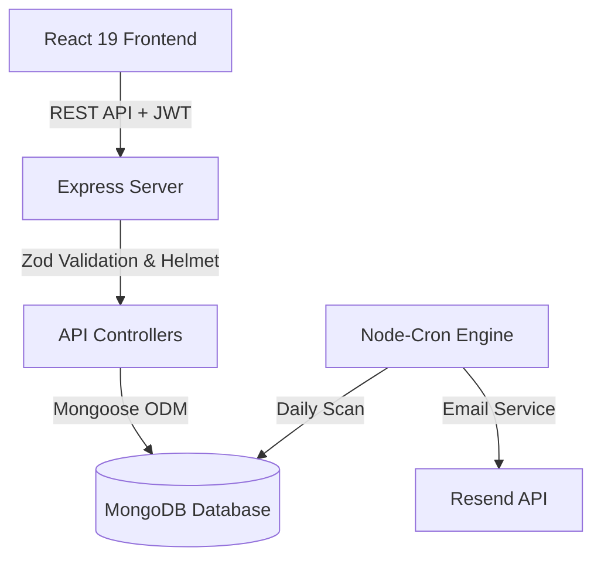

# JobPulse 🚀

<div align="center">
  <p><strong>Smart Job Application & Interview Operating System</strong></p>
  <p>Never lose track of a job opportunity again. JobPulse manages your job search pipeline, tracks interviews, calculates source conversion rates, auto-detects ghosted applications, and sends intelligent follow-up & deadline alerts.</p>
</div>

---

## The Problem

Job hunting across multiple job boards (LinkedIn, Indeed, company career pages, referrals) quickly leads to disorganization. Candidates miss critical interview prep, let follow-up windows close, fail to notice application deadlines, and lose track of which sources actually yield responses.

**JobPulse** solves this by providing a unified, visual Kanban search operating system paired with an automated background engine that ensures proactive follow-ups, deadline countdowns, interview scheduling, and rich data analytics.

---

## Features ✨

- 🗂️ **Kanban Pipeline Board**: Drag and drop applications across 6 stages (*Wishlist*, *Applied*, *Assessment*, *Interview*, *Offer*, *Rejected*).
- 🤖 **AI Career Intelligence**: Gemini-powered resume matching, job description analysis, interview transcript extraction, and interactive Copilot.
- 🎓 **Role-Based Access Control (RBAC)**: Dedicated portals for Students, Placement Officers, Mentors, Institution Admins, and Super Admins.
- 🏢 **Placement Drives & Opportunities**: Institutional job boards to track campus placements and external roles.
- 🎙️ **Interview Tracker**: Multi-round scheduling for Phone, Video, Technical, HR, Behavioral, and On-site interviews with interviewer contacts and meeting links.
- ✅ **Task & Readiness Tracker**: Action item lists and interview preparation readiness scoreboards.
- ⚡ **Follow-Up Nudge Engine**: Daily background cron job scans for stale applications and sends automated follow-up reminders.
- 👻 **Ghost Job Detection**: Automatically identifies applications stuck in *Applied* or *Assessment* for 30+ days without updates.
- ⏰ **Deadline Reminders & Countdowns**: Dynamic badges on Kanban cards ("3 days left", "Today", "Closed") with automated deadline reminder emails.
- 📊 **Analytics & Source Conversion**: Deep insights into response rates, avg days to interview/offer, weekly activity, and conversion by application source.
- 🔒 **Security Hardened**: Protected with `Helmet` security headers, strict IP rate limiters, JWT authentication, and full `Zod` request body validation.

---

## Tech Stack 🛠️

### Frontend
- **Framework**: React 19 + Vite
- **Routing**: React Router DOM v7
- **Styling**: Vanilla CSS (Glassmorphism design system) + Tailwind CSS v4
- **Visualization**: Recharts

### Backend
- **Runtime**: Node.js + Express
- **Database**: MongoDB Atlas + Mongoose ODM (indexed schemas)
- **AI Integration**: @google/genai (Gemini 3.6 Flash)
- **Validation**: Zod v4 (Strict request validation & coercion)
- **Security**: Helmet (HTTP security headers) & Express Rate Limit
- **Automation**: Node-Cron (Background processing)
- **Email Service**: Resend API
- **Auth**: JWT (JSON Web Tokens) + Bcryptjs
- **Testing**: Jest + Supertest + MongoDB Memory Server

---

## System Architecture 🏗️



1. **Client**: Single-page application built with responsive glassmorphism UI, real-time board interaction, and Analytics views.
2. **Express API**: Handles REST endpoints for Auth, Applications, Interviews, Dashboard Stats, and Settings.
3. **Mongoose Models**: Indexed schemas (`User`, `Application`, `Interview`) with compound indexes for instant query responses.
4. **Automation Engine**: Executes scheduled passes for stale application nudges, ghost flagging, and deadline notifications.

---

## Local Setup Instructions 💻

### Prerequisites
- Node.js (v18 or higher)
- MongoDB Connection String (Atlas or local instance)
- Resend API Key *(Optional — email sending will be safely bypassed if omitted)*

### 1. Clone & Install Dependencies

```bash
git clone https://github.com/yourusername/JobPulse.git
cd JobPulse

# Install backend dependencies
cd server
npm install

# Install frontend dependencies
cd ../client
npm install
```

### 2. Configure Environment Variables

Create a `.env` file in the `server` directory (refer to `.env.example`):

```env
PORT=5000
NODE_ENV=development
MONGO_URI=mongodb+srv://<user>:<password>@cluster.mongodb.net/jobpulse
JWT_SECRET=your_secure_random_jwt_secret_key_here
CLIENT_URL=http://localhost:5173

# Optional Email Configuration
RESEND_API_KEY=re_your_resend_api_key
FROM_EMAIL=JobPulse <onboarding@resend.dev>
```


### 3. Run Development Servers

**Terminal 1 (Backend API):**
```bash
cd server
npm run dev
```

**Terminal 2 (Frontend Client):**
```bash
cd client
npm run dev
```

Open `http://localhost:5173` in your browser.

---

## API Summary 🔌

| Endpoint | Method | Description |
| :--- | :--- | :--- |
| `/api/auth/register` | `POST` | Register new user account |
| `/api/auth/login` | `POST` | Authenticate user & receive JWT token |
| `/api/auth/me` | `GET` | Fetch authenticated user profile |
| `/api/auth/settings` | `PATCH` | Update notification & follow-up preferences |
| `/api/applications` | `GET/POST` | List user applications / Create application |
| `/api/applications/:id` | `PUT/DELETE` | Update application / Delete application |
| `/api/interviews` | `GET/POST` | Get all interviews / Create new interview round |
| `/api/interviews/upcoming` | `GET` | Get upcoming scheduled interviews (next 14 days) |
| `/api/dashboard/stats` | `GET` | Fetch aggregated analytics & source conversion stats |
| `/api/nudge/run` | `POST` | Manually trigger follow-up & ghost check |

---

## License

MIT License © JobPulse.
